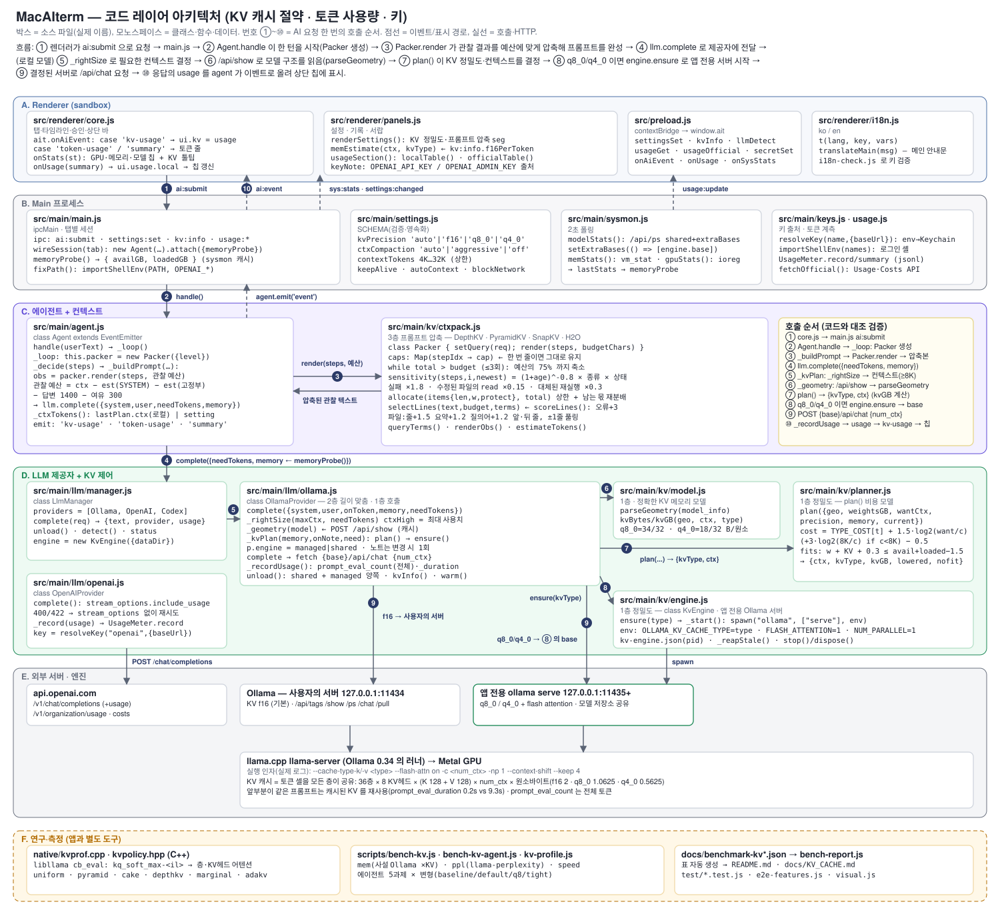
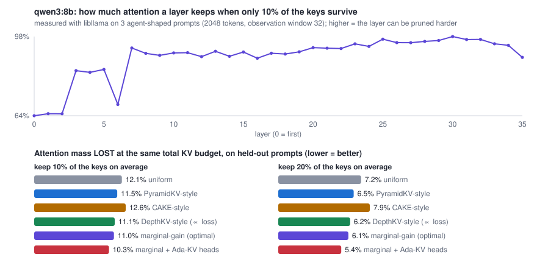

# KV 캐시 절약 설계 — 논문 조사 · 알고리즘 · 구현 · 실측

> 이 문서의 **모든 숫자는 이 저장소의 스크립트가 측정 환경(Apple M4 · 16GB · Ollama 0.34.1 · llama.cpp 0.5.0)에서 실제로 잰 값**입니다. 표는 `docs/benchmark-kv*.json` 에서 `scripts/bench-report.js` 가 자동 생성합니다(손으로 옮겨 적지 않음). 무엇이 **실제로 배포되어 동작**하고 무엇이 **측정·연구용**인지를 4절과 8절에서 분리해 적었습니다.

## 0. 한눈에 보기

| | 내용 | 상태 |
|---|---|---|
| **1층 정밀도** | KV 캐시를 f16 → q8_0 → q4_0 으로 줄이는 앱 전용 Ollama 엔진 + 메모리 여유에 따라 고르는 플래너 | **배포됨** · 실측 |
| **2층 길이 맞춤** | 프롬프트 압축 뒤 필요한 만큼만 컨텍스트를 잡는 "context right-sizing" | **배포됨** · 실측 |
| **3층 프롬프트** | DepthKV 식 "민감도 기반 예산 배분"을 에이전트 프롬프트(관찰 결과)에 적용한 민감도 기반 압축 + 앞부분 유지(prefix 보존) 구조 | **배포됨** · 품질 유지 확인(압축이 발동하는 긴 입력의 효과는 미검증, 7절) |
| **4층 연구** | libllama 로 실제 모델의 **층별 어텐션 민감도**를 재는 C++ 프로파일러와 층별 예산 정책(균등·PyramidKV·CAKE·DepthKV·한계이득) 비교 | 앱과 별도로 쓰는 측정 도구 — 엔진이 층별 KV 를 지원하지 않아 **적용은 불가** |

### 측정 요약 (qwen3:8b)

<!-- bench:kvmem:start -->
| 모델 | 컨텍스트 | 이전(기본 Ollama, f16) | f16 + flash attention | **q8_0** | **q4_0** | q8_0 절약 | q4_0 절약 | 속도 (tok/s) f16 → q8_0 → q4_0 |
|---|---|---|---|---|---|---|---|---|
| `qwen3:8b` | 4K | 5.92GB | 5.92GB | **5.65GB** | **5.49GB** | −0.27GB (5%) | −0.43GB (7%) | 19.7 → 19.5 → 19.4 |
| `qwen3:8b` | 12K | 7.14GB | 7.24GB | **6.41GB** | **5.96GB** | −0.73GB (10%) | −1.18GB (17%) | 19.7 → 19.6 → 19.3 |
| `qwen3:8b` | 32K | 9.91GB | 10.26GB | **8.01GB** | **6.8GB** | −1.90GB (19%) | −3.11GB (31%) | 19.5 → 19.5 → 19.3 |
| `qwen3:14b` | 12K | 10.99GB | 11.42GB | **10.05GB** | **9.55GB** | −0.94GB (9%) | −1.44GB (13%) | 8.9 → 9.8 → 6.5 |
| `qwen3:14b` | 16K | 12.48GB | 12.48GB | **10.41GB** | **9.74GB** | −2.07GB (17%) | −2.74GB (22%) | 2.9 → 7.5 → 6.5 |
<!-- bench:kvmem:end -->

## 1. 배경

KV 캐시는 트랜스포머가 지금까지 본 토큰의 키(K)·값(V)을 **층마다** 저장해 두는 작업 메모리입니다. 크기는 다음과 같이 **미리 컨텍스트 전체 길이만큼 확보**됩니다.

```
KV 바이트 = 컨텍스트 토큰 × Σ(층) KV헤드수 × (키 폭 + 값 폭) × 원소 바이트
qwen3:8b  = 36층 × 8 KV헤드 × (128 + 128) × 2바이트(f16) = 147,456 B/토큰 = 144 KiB/토큰
            → 12K 컨텍스트 1.81GB · 32K 컨텍스트 4.83GB (실제로 쓰는 양과 무관하게 확보)
```

Apple Silicon 은 CPU·GPU 가 같은 메모리를 쓰므로 16GB Mac 에서는 가중치 5.2GB 외에 KV 캐시가 곧 "다른 앱에 줄 메모리"입니다. 이 앱은 이전에 `0.00015 GB/토큰` 이라는 경험칙으로 추정했는데, 이제 모델 메타데이터(`/api/show`)의 실제 구조로 계산합니다(`src/main/kv/model.js`, 측정과의 오차는 아래 표의 "예측" 열).

## 2. 문헌 조사

(링크는 arXiv; 내용은 해당 논문의 초록·본문에서 확인한 것만 적었습니다.)

| 방법 | 핵심 아이디어 | 작동 위치 | Ollama/llama.cpp 에서 쓸 수 있나 | 이 프로젝트에서 가져온 것 |
|---|---|---|---|---|
| **DepthKV** ([2604.24647](https://arxiv.org/abs/2604.24647), 2026) | 층마다 가지치기에 대한 **민감도**가 다르다. 전체 KV 예산은 고정하고 **민감한 층에 더, 둔한 층에 덜** 배분(균등 배분보다 같은 총량에서 우수). 민감도는 층별 ablation 과 표현 지표(InfoNCE)로 측정, 배분은 지표 비례 + 층당 최대 가지치기율 상한(0.7)을 넘으면 남는 몫을 **반복 재분배**, 첫 층은 가지치기 제외, 층 내부 선택은 H2O. 프리필 중에만(청크 1024) 가지치기 | 모델 내부(층별 KV) | **불가** (토큰 셀이 모든 층에 공유됨) | **예산 배분 알고리즘**(상한·반복 재분배·보호 구간) → 3층에서 프롬프트의 관찰 결과에 적용, 4층에서 층별로 측정 |
| **PyramidKV** ([2406.02069](https://arxiv.org/abs/2406.02069)) | 아래층은 어텐션이 넓게 퍼지고 위층은 소수 토큰에 모인다("정보 깔때기") → 층별 예산을 **등차수열로 아래 ↑ 위 ↓** | 모델 내부 | 불가 | 최근성에 따른 가중 감소(3층), 정책 비교의 하나(4층) |
| **CAKE** ([2503.12491](https://arxiv.org/abs/2503.12491), ICLR'25) | 층의 **공간적 분산(엔트로피)** 과 **시간적 이동(분산)** 으로 층 선호도를 계산해 "케이크 자르듯" 배분, 프리필 중 단계적 관리 | 모델 내부 | 불가 | 4층 정책 비교 |
| **Ada-KV** ([2407.11550](https://arxiv.org/abs/2407.11550), NeurIPS'25) | 한 층 안에서 **헤드별** 예산 적응 — 헤드 풀링 top-k. 어텐션 출력 오차의 상한을 이론으로 제시(보존한 어텐션 질량이 핵심) | 모델 내부 | 불가 | 평가 지표(보존 어텐션 질량), 헤드 풀링 비교 |
| **SnapKV** ([2404.14469](https://arxiv.org/abs/2404.14469), NeurIPS'24) | 프롬프트 **끝의 관찰 창**(기본 32)의 어텐션이 중요한 앞부분 토큰을 미리 알려준다 + max-pooling(커널 5)으로 이웃 보존 | 프리필 | 불가(어텐션 접근 필요) | **줄 단위 점수화**: 요청+최근 오류를 관찰 창으로, ±1줄 풀링 |
| **H2O / StreamingLLM** ([2306.14048](https://arxiv.org/abs/2306.14048), [2309.17453](https://arxiv.org/abs/2309.17453)) | 누적 어텐션이 큰 "heavy hitter" + 최근 토큰 / 처음 몇 토큰(attention sink) + 최근 창 | 디코드 | Ollama 의 `--context-shift --keep 4` 가 StreamingLLM 식 정책(실측: Ollama 가 llama-server 를 이런 인자로 실행) | 앞·뒤 줄 가산점(헤더/요약), 반복 등장 식별자 가산 |
| **KIVI** ([2402.02750](https://arxiv.org/abs/2402.02750), ICML'24) | KV **양자화**: 키는 채널별, 값은 토큰별로 비대칭 2비트. 키가 더 민감 | 저장 형식 | llama.cpp 의 블록 양자화(q8_0/q4_0)로 **가능** | 1층: 양자화 KV. 키/값 비대칭 조합은 직접 측정(5절) |
| **FreqDepthKV** ([2607.06519](https://arxiv.org/abs/2607.06519), 2026) | 인접 층의 KV 를 DCT 로 저주파(공유)+고주파(잔차)로 분해해 **층 간 공유** | 모델 내부 | 불가 | (참고) |
| **The Complexity Trap** ([2508.21433](https://arxiv.org/abs/2508.21433), 2025) | 에이전트 컨텍스트 관리에서 **오래된 관찰을 단순히 가리는 것(observation masking)** 이 LLM 요약과 같은 성능을 절반 비용으로 낸다 | 에이전트 프롬프트 | **가능**(앱 수준) | 3층: 추가 모델 호출 없는 순수 텍스트 선택 |

## 3. 핵심 제약 — 무엇이 "진짜로" 가능한가

- Ollama 0.34 는 내부적으로 **llama.cpp 의 `llama-server`** 를 실행합니다(`--cache-type-k/-v … --flash-attn on --context-shift --keep 4`, 실행 로그에서 확인).
- llama.cpp 의 KV 캐시는 **토큰 셀을 모든 층이 공유**합니다. DepthKV·PyramidKV·CAKE 처럼 *층마다 다른 토큰 집합/개수*를 유지하려면 어텐션 그래프와 캐시 구조를 고친 포크가 필요합니다. → 이 앱은 **엔진을 고치지 않고** 할 수 있는 것만 배포합니다.
- 가능한 것: (a) **저장 정밀도**(q8_0/q4_0, flash attention 필요) — 서버 전역 설정, (b) **프롬프트에 무엇을 넣을지**(앱이 100% 통제), (c) **얼마나 확보할지**(num_ctx).

## 4. 아키텍처

### 4.1 코드 레이어 아키텍처 (파일·클래스·함수 수준)



### 4.2 개념도 (4층)

```
                      ┌────────────────────────── 사용자 요청 ──────────────────────────┐
                      ▼                                                                 │
   3층  프롬프트  ctxpack.js ── 관찰 결과를 민감도 기반 예산으로 압축(DepthKV식 배분 + SnapKV식 줄 선택)
        (앱 수준)      │         · 앞부분 유지: 예산을 넘을 때만 한 번 줄이고 되돌리지 않음 → 앞부분이 안 바뀌어 KV 재사용
                       ▼
   2층  길이 맞춤  ollama.js `_rightSize` ── 압축된 프롬프트가 들어갈 가장 작은 컨텍스트(≥8K)로 시작, 필요할 때만 확대
                       ▼
   1층  정밀도     planner.js ── (모델 구조, 가용 메모리, 사용자 설정) → (KV 정밀도, 컨텍스트)  [비용 모델]
                    engine.js ── 앱 전용 `ollama serve`(OLLAMA_KV_CACHE_TYPE + FLASH_ATTENTION) 시작/교체/종료
                       ▼
                    Ollama(llama-server) ── 실제 추론
   ─────────────────────────────────────────────────────────────────────────────────────────────────
   4층  연구       native/kvprof.cpp + kvpolicy.hpp ── libllama 로 층별 어텐션을 재고 정책을 비교(배포 대상 아님)
```

파일: `src/main/kv/{model,planner,engine,ctxpack}.js`, `src/main/llm/ollama.js`(통합), `native/{kvpolicy.hpp,kvprof.cpp}`, 측정 `scripts/{bench-kv,bench-kv-agent,kv-profile}.js`.

## 5. 알고리즘

### 5.1 KV 메모리 모델 (`model.js`)
`/api/show` 의 `model_info` 에서 층 수, 층별 KV 헤드 수(배열 지원), 키/값 폭, 슬라이딩 윈도(gemma 식 `sliding_window` + `pattern`)를 읽어 위 식으로 정확히 계산합니다. 블록 양자화의 원소당 바이트는 llama.cpp 의 값(`q8_0 = 34/32`, `q4_0 = 18/32`)을 씁니다. 알 수 없는 구조는 기존 경험칙으로 대체합니다.

### 5.2 KV 플래너 (`planner.js`)
후보 (정밀도 t, 컨텍스트 c) 마다 **품질 손실 비용**을 매기고 메모리에 들어가는 후보 중 최소 비용을 고릅니다.

```
cost(t, c) = TYPE_COST[t] + 1.5·log2(원하는 컨텍스트 / c) + (c < 8K 이면 3·log2(8K / c))   (현재 엔진과 같은 t 면 −0.5)
TYPE_COST  = { f16: 0, q8_0: 0.6, q4_0: 3.5 }                       ← 5절의 perplexity 실측으로 정함
들어가는가  = 가중치 + KV(c, t) + 0.3GB ≤ 가용 + 이미 올라온 몫 − 1.5GB   (f16 은 +0.5GB 여유를 더 요구)
```
* 메모리가 넉넉하면 **f16**(가장 빠르고 정확), 빠듯하면 **q8_0**(≈ 무손실), 그래도 안 되면 컨텍스트를 줄이되 **8K 아래로는 큰 벌점**.
* 아무것도 안 들어가면 가장 작은 구성을 고르되 정밀도는 높게 두고 `nofit` 으로 사용자에게 알립니다.
* 직접 고른 정밀도(f16/q8_0/q4_0)는 그대로 지키고 컨텍스트만 줄입니다.

### 5.3 앱 전용 엔진 (`engine.js`)
KV 정밀도는 Ollama **서버 전역**이므로 사용자의 Ollama 를 건드리지 않고 `127.0.0.1` 사설 포트에 `OLLAMA_KV_CACHE_TYPE=<t>`, `OLLAMA_FLASH_ATTENTION=1`, `OLLAMA_NUM_PARALLEL=1` 로 **별도 서버**를 띄웁니다(모델 저장소 공유 — 복사·다운로드 없음). 종류가 바뀌면 교체, 앱 종료 때 정리, 비정상 종료로 남은 서버는 다음 실행 때 pid 파일로 회수합니다. `OLLAMA_HOST` 를 직접 지정했거나 `AIT_KV_ENGINE=off` 면 꺼집니다.

### 5.4 민감도 기반 프롬프트 압축 (`ctxpack.js`)
에이전트 프롬프트의 토큰은 **모든 층의 KV 를 똑같이 차지**하므로 프롬프트를 줄이는 것이 곧 균등 가지치기입니다. DepthKV 의 "한정된 총량을 민감도로 나눈다"를 **관찰 결과(명령 출력·파일 내용·검색 결과)** 에 적용했습니다.

1. **민감도** `w_i = (1+age)^-0.8 × 종류 × 상태` — 최근일수록(PyramidKV 식 감소), 실패한 명령 ×1.8(근거가 담김), 이후에 수정된 파일의 이전 `read_file` ×0.15(낡은 내용), 같은 명령이 나중에 성공하면 이전 실패 ×0.25, 같은 명령의 재실행으로 대체된 것 ×0.3.
2. **배분** `allocate()` — 총 예산을 `w_i` 비례로 나누되 **각 항목은 자기 길이를 넘지 않게** 상한을 두고, 상한에 닿은 항목의 남는 몫을 나머지에 **반복 재분배**(DepthKV 의 ρ_max 처리와 같은 절차). 가장 최근 관찰은 보호 구간.
3. **줄 선택** `selectLines()` — SnapKV 식: 요청과 최근 오류의 식별자를 기준(SnapKV 의 관찰 창 역할)으로 삼아 줄 점수(오류 +3, 파일:줄 +1.5, 요약 +1.2, 질의어 일치 +1.2/개, 앞·뒤 3줄 가산, 중복·장식줄 감점)를 매기고 ±1줄 풀링, 점수/길이 순으로 예산까지 채운 뒤 원래 순서로 `…(N줄 생략)…` 표시.
4. **앞부분 유지(KV 재사용)** — 프롬프트가 예산을 넘을 때만 한 번에 예산의 75% 까지 줄이고, 한 번 줄인 관찰은 다시 커지지 않습니다. 그 사이에는 프롬프트가 **덧붙이기만** 되어 Ollama 가 앞부분 KV 를 재사용합니다.

### 5.5 컨텍스트 길이 맞춤 (`ollama.js`)
기본 프롬프트 예산은 12K 컨텍스트의 절반 정도만 썼지만 KV 는 12K 전체가 확보됐습니다(실제 토크나이저로 측정: 한국어 시스템 프롬프트 0.49 토큰/글자, 코드 0.32, 로그 0.35). 압축이 켜져 있으면 **필요한 가장 작은 단계(≥8K)** 로 시작하고 더 큰 프롬프트가 필요할 때만 한 번 키웁니다(모델 재로드 1회). 사용자의 "컨텍스트 길이"는 상한입니다.

### 5.6 층별 정책 연구 도구 (`native/`)
`kvprof` 는 libllama 로 프롬프트를 한 번 처리하며 flash attention 을 끄고 `kq_soft_max` 텐서를 읽어, **마지막 32개 위치(관찰 창)** 의 어텐션을 KV 헤드별(GQA 그룹 평균)로 모아 층별 "상위 B 개 키가 가진 어텐션 질량" 곡선·엔트로피·분산을 만듭니다. `kvpolicy.hpp` 가 같은 총 예산에서 균등/PyramidKV/CAKE/DepthKV 식/한계이득 배분과 Ada-KV 헤드 풀링을 계산하고, **보정 프롬프트로 정한 예산을 따로 둔 평가 프롬프트에서** 잃는 어텐션 질량으로 비교합니다. 대리 지표이며 과제 정확도가 **아닙니다**.

## 6. 실측 결과

### 6.1 메모리 · 속도 — 앱이 실제로 쓰는 경로 (Ollama, 같은 모델·같은 질문)

<!-- bench:kvmem:start -->
| 모델 | 컨텍스트 | 이전(기본 Ollama, f16) | f16 + flash attention | **q8_0** | **q4_0** | q8_0 절약 | q4_0 절약 | 속도 (tok/s) f16 → q8_0 → q4_0 |
|---|---|---|---|---|---|---|---|---|
| `qwen3:8b` | 4K | 5.92GB | 5.92GB | **5.65GB** | **5.49GB** | −0.27GB (5%) | −0.43GB (7%) | 19.7 → 19.5 → 19.4 |
| `qwen3:8b` | 12K | 7.14GB | 7.24GB | **6.41GB** | **5.96GB** | −0.73GB (10%) | −1.18GB (17%) | 19.7 → 19.6 → 19.3 |
| `qwen3:8b` | 32K | 9.91GB | 10.26GB | **8.01GB** | **6.8GB** | −1.90GB (19%) | −3.11GB (31%) | 19.5 → 19.5 → 19.3 |
| `qwen3:14b` | 12K | 10.99GB | 11.42GB | **10.05GB** | **9.55GB** | −0.94GB (9%) | −1.44GB (13%) | 8.9 → 9.8 → 6.5 |
| `qwen3:14b` | 16K | 12.48GB | 12.48GB | **10.41GB** | **9.74GB** | −2.07GB (17%) | −2.74GB (22%) | 2.9 → 7.5 → 6.5 |
<!-- bench:kvmem:end -->

* "예측"(가중치 + 정확한 KV 모델)과 측정값의 차이는 +0.0~0.4GB(8B)·−0.3~+0.5GB(14B)였고, 플래너가 더하는 여유 0.3GB 가 이를 덮습니다.
* 14B 의 속도 열은 측정 중 다른 프로그램(테스트용 Electron 등)이 켜져 있어 흔들렸습니다(f16 16K 에서 2.9 tok/s 는 메모리 압박 → 스왑 영향). 메모리 열은 영향을 받지 않습니다.

### 6.2 품질 — KV 양자화의 비용 (perplexity, 낮을수록 좋음)

같은 GGUF 파일을 `llama-perplexity` 로 돌려 KV 형식만 바꿨습니다(코퍼스: 이 저장소의 한국어 README + JS 소스, 약 27만 자).

<!-- bench:kvppl:start -->
| K 캐시 | V 캐시 | KV 크기(f16 대비) | PPL @ 2K (Δ) | PPL @ 8K (Δ) |
|---|---|---|---|---|
| f16 | f16 | 100% | 5.981 (+0.000) | 5.011 (+0.000) |
| q8_0 | q8_0 | 53% | 5.977 (-0.004) | 5.009 (-0.002) |
| q4_0 | q4_0 | 28% | 6.045 (+0.064) | 5.015 (+0.003) |
<!-- bench:kvppl:end -->

### 6.3 속도 — 입력 처리/생성 (llama-bench, 같은 GGUF)

<!-- bench:kvspeed:start -->
| K 캐시 | V 캐시 | 입력 처리 pp512 (tok/s) | 입력 처리 pp2048 (tok/s) | 생성 tg64 (tok/s) |
|---|---|---|---|---|
| f16 | f16 | 164.6 | 138 | 14.8 |
| q8_0 | q8_0 | 130.8 (−21%) | 123.3 (−11%) | 15.4 (+4%) |
| q4_0 | q4_0 | 124.3 (−24%) | 126.2 (−9%) | 14.9 (+1%) |
| q8_0 | q4_0 | 75.9 (−54%) | 40.3 (−71%) | 11 (−26%) |
<!-- bench:kvspeed:end -->

### 6.4 층별 정책 비교 (C++ 프로파일러, 실제 qwen3:8b 어텐션)



<!-- bench:kvlayers:start -->
| 정책 (총 KV 예산 동일) | 평균 5% 유지 시 잃는 어텐션 | 평균 10% 유지 시 잃는 어텐션 | 평균 20% 유지 시 잃는 어텐션 | 평균 40% 유지 시 잃는 어텐션 |
|---|---|---|---|---|
| 균등 (H2O·SnapKV 기본) | 17.5% | 12.1% | 7.2% | 3.0% |
| PyramidKV 식 (아래층 ↑) | 17.0% (−3%) | 11.5% (−5%) | 6.5% (−9%) | 2.6% (−13%) |
| CAKE 식 (엔트로피×변동) | 17.8% (+2%) | 12.6% (+4%) | 7.9% (+10%) | 4.0% (+32%) |
| DepthKV 식 (손실에 비례) | 16.7% (−5%) | 11.1% (−8%) | 6.2% (−13%) | 2.4% (−22%) |
| 한계이득 균등화 (대리지표 최적) | 16.5% (−6%) | 11.0% (−9%) | 6.1% (−15%) | 2.2% (−27%) |
| Ada-KV (균등 층 + 헤드 풀링) | 16.8% (−4%) | 11.5% (−5%) | 6.6% (−8%) | 2.6% (−14%) |
| 한계이득 + Ada-KV | 15.8% (−9%) | 10.3% (−15%) | 5.4% (−24%) | 1.8% (−40%) |
| (상한) 같은 프롬프트로 보정 | 16.4% (−6%) | 11.0% (−10%) | 6.0% (−16%) | 2.1% (−29%) |
<!-- bench:kvlayers:end -->

### 6.5 에이전트 과제에서 품질이 유지되는가 (실제 에이전트 + 실제 셸 + 실제 모델)

<!-- bench:kvagent:start -->
| 설정 | 통과 | 총 시간 | 입력 처리 시간 합계† (호출 수) | 호출당 평균 처리 시간 | 호출당 입력 토큰(전체) | 사용한 컨텍스트 · KV | 측정된 최대 상주 메모리 |
|---|---|---|---|---|---|---|---|
| 이전 (f16 · 기존 프롬프트 정리 · 12K) | 4/5 | 296초 | 58.6초 (31회) | 1.89초 | 2150 | 12K · f16 (1.81GB) | **6.79GB** |
| **새 기본값** (자동 KV · 민감도 기반 압축 · 컨텍스트 맞춤) | 4/5 | 362초 | 56.6초 (32회) | 1.77초 | 2163 | 8K · f16 (1.21GB) | **6.53GB** |
| **q8_0 고정** (앱 전용 엔진 · 압축 · 컨텍스트 맞춤) | 5/5 | 560초 | 84.4초 (39회) | 2.16초 | 2358 | 8K · q8_0 (0.64GB) | **5.62GB** |
| 극단 절약 (q4_0 · 강한 압축) | 4/5 | 658초 | 101.5초 (46회) | 2.21초 | 2548 | 8K · q4_0 (0.34GB) | **5.67GB** |

과제별 결과 (통과/실패 · 초)

| 과제 | baseline | default | q8 | tight |
|---|---|---|---|---|
| 구조 설명 | 통과 · 35초 | 통과 · 34초 | 통과 · 51초 | **실패** · 26초 |
| 버그 수정(JS) | 통과 · 67초 | 통과 · 52초 | 통과 · 68초 | 통과 · 76초 |
| 코딩: 기능+테스트 추가 | **실패** · 108초 | **실패** · 173초 | 통과 · 277초 | 통과 · 265초 |
| 코딩: 버그 수정(Python) | 통과 · 66초 | 통과 · 79초 | 통과 · 136초 | 통과 · 264초 |
| 터미널: 파일 정리 | 통과 · 20초 | 통과 · 24초 | 통과 · 28초 | 통과 · 27초 |
<!-- bench:kvagent:end -->

> **측정 시점** — default · q8 · tight 행은 프롬프트 압축 모드의 `(이후 수정됨)` 꼬리표 결함(7절)을 고친 빌드로 **2026-10-05 에 다시 쟀습니다**(baseline 행은 결함이 없는 이전 빌드의 값으로 그대로입니다). 다만 이 측정은 **조용한 Mac 이 아니었습니다**(다른 앱이 열려 있었고 8B 모델 + 앱 전용 엔진만 추가로 돌렸습니다). 과제당 1회·temperature 0.1 이라 통과/실패와 시간은 실행마다 달라질 수 있어, **변형 사이의 통과 수 차이(4/5 · 4/5 · 5/5 · 4/5)는 유의하다고 말할 수 없습니다.** 메모리(최대 상주량)와 호출당 입력 처리 시간은 비교적 안정적인 값입니다.

† 입력 처리 시간 = Ollama 가 보고한 `prompt_eval_duration` 의 합. 이 버전의 `prompt_eval_count` 는 캐시된 앞부분까지 **전체 프롬프트 토큰**을 세므로, KV 재사용은 토큰 수가 아니라 **처리 시간**에 나타납니다(직접 확인: 같은 앞부분 3,274토큰 0.22초 · 앞부분이 다르면 9.3초 · 첫 호출 18.7초).

## 7. 해석과 한계

**확인된 것 (모두 위 표의 실측)**

1. **KV 양자화(q8_0)는 품질 손실이 측정 오차 안**입니다. perplexity 5.981 → 5.977(2K), 5.011 → 5.009(8K). 메모리(측정된 상주량)는 qwen3:8b 32K 컨텍스트에서 f16 10.26GB → q8_0 8.01GB(−22%) · q4_0 6.80GB(−34%)이고, 예측 모델 오차는 +0.2GB 안쪽입니다(예측 10.06 / 7.80 / 6.59GB).
2. **q4_0 은 2K 에서 +1.1%(5.981 → 6.045), 8K 에서 +0.07%** 로 둘 다 표준오차(±0.1~0.13) 안이라 "열화가 있다"고 단정할 수 없고 "q8_0 보다 나쁜 쪽"까지만 말할 수 있습니다. 그래서 플래너의 TYPE_COST 에서 q8_0 은 0.6, q4_0 은 3.5 로 크게 벌렸습니다(보수적).
3. **속도 비용**: 입력 처리는 f16 164.6 → q8_0 130.8(−21%) · q4_0 124.3(−24%) tok/s, 생성은 같습니다. 메모리가 넉넉하면 f16 을 쓰는 이유입니다. 비대칭 K=q8_0/V=q4_0 은 pp2048 에서 −71%, 생성 −26% 라 제외했습니다.
4. **프롬프트 캐시 재사용은 실제로 동작**합니다. 같은 앞부분의 3,275토큰 프롬프트는 입력 처리 0.47초, 앞부분이 다르면 14.6초(약 30배 차이)입니다. 이 Ollama 버전의 `prompt_eval_count` 는 캐시된 토큰까지 센 전체 토큰이라 재사용은 토큰 수가 아니라 **처리 시간**에 나타납니다.
5. **에이전트 5과제**(결함 수정 후 재측정): baseline 4/5 · 새 기본값 4/5 · q8_0 고정 5/5 · 극단 절약 4/5 로 **통과 수가 떨어지지 않았습니다**(우연의 범위 — 6.5절 주의). 최대 상주 메모리는 6.79GB → 6.53GB(컨텍스트 맞춤만) → 5.62GB(q8_0 고정)로 q8_0 고정은 **−1.17GB(−17%)** 입니다(이전 측정에서 컨텍스트 맞춤만 6.18GB 였으므로 이 값은 실행마다 0.3GB 안팎 흔들립니다). 호출당 입력 처리 시간은 f16 계열(baseline · 새 기본값)이 약 1.8~1.9초, q8_0 · q4_0 이 약 2.2초로 3번 항목의 처리 속도 차이와 같은 방향입니다.
6. **층별 정책(실제 어텐션, 별도 평가 프롬프트)**: 평균 10% 만 남길 때 잃는 어텐션이 균등 12.1% → DepthKV 식 11.1%(−8%) · 한계이득 11.0%(−9%) · 한계이득+Ada-KV 10.3%(−15%) 이고, **최악 층의 손실은 37.8% → 19.8%(DepthKV 식) · 20.5%(한계이득)** 로 줄었습니다. 보정 프롬프트로 정한 예산이 평가 프롬프트에서도 거의 최적(oracle 과의 차이 0.06%p)이라 일반화는 양호합니다. CAKE 식은 균등보다 오히려 +4% 나빴습니다. 앞쪽 층(0~2, 6)은 어텐션이 넓게 퍼져(10% 만 남기면 64~69% 보존) 뒤쪽 층(≥90%)보다 가지치기에 약합니다.

**확인하지 못했거나 한계인 것**

- **프롬프트 압축(3층)이 실제로 줄이는 장면은 이 벤치에 없었습니다.** 5개 과제 모두 마지막 호출 시점의 관찰 결과가 최대 973자여서(`압축 전 = 압축 후`, 강한 압축 포함) 관찰 예산이나 항목별 상한에 닿지 않았고, 내용을 줄이는 압축은 한 번도 발동하지 않았습니다(압축 모드의 꼬리표 결함은 이와 별개로 작동했습니다 — 아래). 동작은 단위 테스트(`allocate` · `selectLines` · `Packer`)로 검증했을 뿐, "긴 출력에서 얼마나 줄이고 품질이 유지되는가"는 측정하지 않았습니다. 새 기본값의 메모리 절감(이번 −0.26GB, 이전 −0.6GB)은 압축이 아니라 **컨텍스트 맞춤(12K → 8K)** 효과입니다.
- **결함 수정 후 새 기본값의 호출 수는 baseline 과 같아졌습니다(32회 vs 31회, 수정 전 37회).** 호출당 입력 처리 시간도 같습니다(1.77초 vs 1.89초). 총 시간(362초 vs 296초) 차이는 입력 처리가 아니라 과제별 단계 수와 출력 생성 시간에서 나왔고, 변형당 1회 실행이라 우연과 구분하지 못합니다. (결함의 원인과 수정: 압축 모드가 읽은 파일에 붙이던 `(이후 수정됨)` 꼬리표를 본 `qwen3:8b` 가 이미 끝난 수정을 되풀이하다 "연속 3회 실패" 로 멈추는 일이 있었고(같은 작업 폴더에서 압축 켬 0/2 · 끔 2/2 · 이전 코드 2/2, 수정 후 3/3), 꼬리표는 실제로 잘린 관찰에만 붙이도록 고쳐 회귀 테스트(`test/kv.test.js`)를 추가했습니다. 처음 측정에서 새 기본값의 입력 처리가 130.8초로 튄 것은 다른 작업이 동시에 돌던 **잡음**이었습니다.)
- **극단 절약(q4_0 + 강한 압축)은 4/5** 였고 실패한 것은 "구조 설명"(명령을 한 번도 실행하지 않고 26초 만에 답함)입니다. 같은 변형이 이전 측정에서는 이 과제를 통과하고 다른 과제(Python 버그 수정)를 놓쳤으므로, 어느 쪽도 q4_0 의 영향으로 단정할 수 없고 **모델의 실행마다 다른 행동**으로 보는 것이 맞습니다(내용 압축은 일어나지 않았습니다).
- "기능+테스트 추가" 과제는 이번에 baseline · 새 기본값이 실패하고 q8_0 · q4_0 은 통과했습니다(이전 측정은 모두 실패). 이 과제는 8B 모델의 성공 여부가 실행마다 갈리는 경계에 있어 **KV 설정의 효과로 해석하지 않습니다.**
- 한 기종(M4 16GB), 한 모델(qwen3:8b)입니다. 14B 는 메모리만 의미가 있고 속도는 측정 중 다른 프로그램의 영향이 컸습니다. perplexity 코퍼스는 이 저장소의 한국어·영어·코드(약 29만 자), 청크 16개(2K)·4개(8K)입니다.
- 층별 정책은 대리 지표(보존 어텐션 질량)이고 **엔진이 층별 KV 를 지원하지 않아 적용하지 못합니다.** 층별 프로파일러의 첫 측정은 모든 프롬프트가 같은 시스템 프롬프트로 시작해 평가 프롬프트가 사실상 같은 텍스트였기 때문에 무효였고, 프롬프트 끝(관찰 창)을 읽도록 고쳐 다시 측정했습니다(문서의 값은 수정 후).

## 8. 적용 가능 범위

* **배포됨**: 1·2·3층(설정 창의 "KV 캐시 정밀도", "프롬프트 압축"). `자동`이 기본이며, `f16` + 압축 `끔` 으로 이전 동작과 같게 되돌릴 수 있습니다.
* **측정 전용**: 4층. DepthKV 가 보고한 "층별 차등 배분이 균등보다 낫다"는 결과는 **모델 내부 가지치기**에서 나온 것이고, 이 저장소는 그 메커니즘을 Ollama/llama.cpp 에 넣지 못했습니다. 4층은 이 모델의 층별 어텐션 구조에서 *대리 지표로* 그 가설이 성립하는지(그리고 어떤 배분 규칙이 성립하는지)를 재는 도구입니다.
* **하지 않은 것**: 토큰 단위 가지치기(H2O/SnapKV)를 엔진에 넣는 것, 층 간 KV 공유(MiniCache/FreqDepthKV), 비대칭 K/V 형식(Ollama 가 지원하지 않고 Metal 에서 느림), 8B 외 모델의 층별 프로파일.

## 9. 재현 방법

```bash
node scripts/bench-kv.js mem        # 메모리·속도: KV 종류 × 컨텍스트 (사설 Ollama 서버, 약 25분)
node scripts/bench-kv.js ppl        # perplexity (llama-perplexity, 약 45분)
node scripts/bench-kv.js speed      # llama-bench 속도
node scripts/build-native.js        # C++ 도구 빌드 + 자체 테스트 (brew install llama.cpp 필요)
node scripts/kv-profile.js qwen3:8b # 층별 어텐션 프로파일 + 정책 비교 → docs/benchmark-kv-layers.json, kv-layer-profile.svg
node scripts/bench-kv-agent.js qwen3:8b   # 에이전트 과제 5종 × (이전 / 새 기본값 / 극단 절약)
node scripts/bench-report.js        # JSON → 이 문서와 README 의 표 갱신
npm test                            # KV 모델·플래너·압축·엔진 단위 테스트 포함
```

측정 중에는 다른 무거운 작업을 하지 마세요(결과가 흔들립니다).
